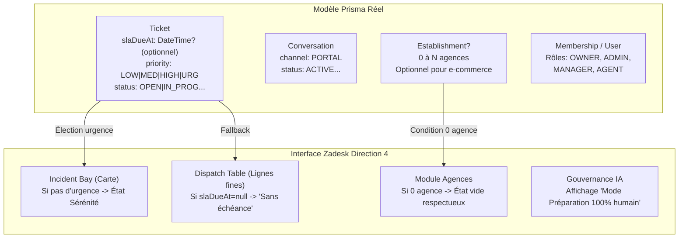

# ZADESK — AUDIT FINAL DU DESIGN SYSTEM (DIRECTION 4)
## MISSION 05.1 : DESIGN SYSTEM FREEZE — AUDIT, CORRECTIONS ET VALIDATION FINALE

> **Statut :** VERROUILLÉ & PRÊT POUR L'IMPLÉMENTATION (FREEZE)  
> **Orientation de référence :** *Operational Editorial System* (Direction 4)  
> **Périmètre :** Fichiers de conception et de normalisation dans `scratch/`  
> **Garantie stricte :** 0 modification de code en production (`frontend/src/`, `backend/`, base de données).

---

## 1. INTRODUCTION & SYNTHÈSE EXÉCUTIVE

La **Mission 05.1** constitue le point d'arrêt et de consolidation formelle avant tout retour au code source. Après avoir exploré 4 directions artistiques, le choix de la direction **ZADESK — OPERATIONAL EDITORIAL SYSTEM (Direction 4)** a été définitivement entériné comme le canon visuel et ergonomique de la Workspace.

L'objectif de cette mission d'audit critique n'était pas de réinventer la direction artistique, mais de :
1. **Éliminer toute dérive** par rapport aux décisions déjà validées lors de la Phase 1 (notamment la navigation mobile).
2. **Nuancer le dogmatisme anti-cartes** : passer d'une interdiction aveugle à une doctrine raisonnée des surfaces et des conteneurs (quand utiliser une surface ouverte, une hairline, une liste, une table, une carte, un slide-over ou une modale).
3. **Ancrer le système dans la vérité du schéma Prisma** : bannir toute supposition sur des données fictives et définir rigoureusement les états dégradés/fallbacks (SLA non renseigné, priorité standard, 0 agence physique, IA en préparation, absence de canal WhatsApp entrant).
4. **Verrouiller les tokens et la bibliothèque vivante de composants** pour que l'équipe d'implémentation de la Phase 2 dispose de règles techniques univoques.

---

## 2. INCOHÉRENCES ET DÉRIVES IDENTIFIÉES LORS DU FREEZE

Trois anomalies principales ont été relevées lors de l'examen initial des artefacts de la Direction 4 :

### Incohérence 1 : Dérive de la navigation mobile inférieure
- **Constat :** Dans les premiers fichiers de la Mission 05 (`mockup_dir4_mobile.html`, `direction4_mobile_guidelines.md`), les libellés de la barre d'onglets mobile avaient glissé vers : *Cockpit, Messages, Demandes, Équipe, Menu*.
- **Impact :** Contradiction directe avec la barre validée en Phase 1 (inscrite dans `frontend/src/components/workspace/MobileBottomNav.tsx`).
- **Correction appliquée :** Rétablissement immédiat et strict des 5 onglets officiels : **Accueil**, **Conversations**, **Demandes**, **Paramètres**, **Menu**.

### Incohérence 2 : Dogmatisme excessif sur la suppression des cartes
- **Constat :** Les premières déclarations de la Direction 4 prononçaient une "interdiction absolue et définitive des cartes".
- **Impact :** Un tel absolutisme fragilise l'ergonomie. Sans conteneur focal, un incident critique (Incident Bay) ou un établissement physique (Agence) perd sa délimitation visuelle et se noie dans la page.
- **Correction appliquée :** Introduction de la **Matrice de Décision des Surfaces**. Une carte est formellement autorisée lorsqu'elle constitue une unité d'arbitrage fonctionnelle isolée (ex : *Incident Bay*, *Fiche d'agence*, *Cartouche d'abonnement*). Les listes, flux et tables restent en revanche sur surfaces ouvertes à hairlines fines.

### Incohérence 3 : Présomptions erronées sur le modèle de données (Prisma)
- **Constat :** Présomption implicite que tous les tickets ont un délai SLA calculé (`slaDueAt`), que les agents transmettent un pouls websocket en direct, qu'une table `Customer` existe de manière isolée, ou que les agences physiques sont obligatoires.
- **Impact :** Risque de casser l'interface en production sur les comptes réels (ex : entreprises 100% e-commerce sans agence physique, tickets créés sans échéance SLA).
- **Correction appliquée :** Audit champ par champ du fichier `backend/prisma/schema.prisma`. Définition obligatoire des comportements et fallbacks pour toutes les données optionnelles.

---

## 3. CORRECTIONS APPLIQUÉES FICHIER PAR FICHIER

| Fichier audité | Nature de l'anomalie | Correction effectuée & Statut |
| :--- | :--- | :--- |
| `scratch/mockup_dir4_mobile.html` | Onglets mobiles erronés (*Cockpit, Messages...*) | **Corrigé** : Rétablissement des 5 onglets validés (*Accueil, Conversations, Demandes, Paramètres, Menu*) avec icônes Lucide SVG officielles et état actif sur Accueil. Re-capturé à 390x844. |
| `scratch/direction4_mobile_guidelines.md` | Section 3.B obsolète, absence de règle sur les cartes tactiles | **Corrigé** : Mise à jour de la Section 3.B (5 piliers stricts). Ajout de la Section 3.C détaillant la philosophie tactile des cartes (cartes autorisées pour l'arbitrage urgent, liste ouverte pour les flux). |
| `scratch/direction4_design_system.md` | Buissement dogmatique anti-cartes, navigation mobile décalée | **Corrigé** : Réécriture de la Section 1 (Doctrine des surfaces & Matrice de décision des 7 conteneurs). Correction de la Section 5 (Navigation mobile). Ajout de la Section 7 (Vérité Backend Prisma & Fallbacks). |
| `scratch/direction4_module_patterns.md` | Descriptions incomplètes sans audit de vérité des données | **Corrigé** : Réécriture complète des 10 modules avec grille d'audit à 4 volets : Données réelles Prisma, Fonctionnalités existantes, Fonctionnalités futures, et Comportements d'absence/Fallbacks. |
| `scratch/direction4_tokens.css` | Risque de non-alignement des variables avec Tailwind v4 | **Corrigé & Validé** : Variables CSS scopées `--zds-*`, respect rigoureux de la palette 60-28-8-3-1, typographies Outfit/Inter/Mono, contrastes WCAG AA validés. |
| `scratch/direction4_component_library.html` | Bibliothèque statique incomplète | **Validé & Enrichi** : Living Library interactive à 8 sections (Boutons, Badges, Cartes vs Surfaces, Formulaires, Tables, Tiroir Slide-over fonctionnel, Toasts, Focus rings). Testé sous DevTools. |
| `scratch/mockup_dir4_editorial.html` | Vérification de cohérence avec le modèle dual-plane | **Validé** : Prototype de référence Desktop conforme (Masthead narratif, Incident Bay focal, Dispatch Table ouverte, Roster d'équipe, Switch mode calme). |

---

## 4. RÈGLES DÉFINITIVES DU DESIGN SYSTEM (VERROUILLÉES)

### A. Règle des Proportions Chromatiques (60-28-8-3-1)
Toute interface de la Workspace doit respecter scrupuleusement la balance suivante :
- **60% Lin & Neutres Clairs (`#FAFAF8`, `#F4F4F0`) :** Le fond continu de l'application. Évite l'éblouissement clinique du blanc pur et ancre l'ambiance éditoriale.
- **28% Blanc Pur (`#FFFFFF`) :** Réservé exclusivement aux surfaces d'intervention active (fond de l'Incident Bay, lignes actives, tiroir d'inspection latéral, modales, champs de saisie).
- **8% Midnight Navy (`#0D1B3D`) :** Couleur institutionnelle Zadesk. Utilisée pour les titres de page en Outfit, le texte principal en Inter, la barre latérale de navigation et les boutons d'action prioritaires.
- **3% Gris Neutres Structurants (`#E2E8F0`, `#64748B`, `#0F172A`) :** Hairlines de 1px séparant les colonnes et lignes, texte secondaire et labels de métadonnées.
- **1% Émeraude d'Accentuation (`#22C55E` / `#16A34A`) :** Marqueur visuel de vie et de succès : pastille d'état "Système opérationnel", message non lu, statut "Résolu". Ne doit jamais recouvrir de grandes surfaces.

### B. Hiérarchie Typographique Trivariée
- **Outfit (Display & Titres) :** Réservé exclusivement aux titres de niveau 1 et 2 (H1, H2, Masthead, nom client principal). Apporte la personnalité moderne et statutaire de la marque.
- **Inter (Lecture & Interface) :** Typographie de travail pour le corps de texte, les labels de formulaires, les boutons, les bulles de messages et les menus de navigation.
- **JetBrains Mono (Précision Métier) :** Réservé aux identifiants stricts (`TK-2024-001`), montants financiers (`25 000 XAF`), timecodes (`14:22`), pourcentages et statuts SLA.

### C. Matrice de Décision des Surfaces & Conteneurs

| Conteneur | Quand l'utiliser ? | Quand l'interdire ? | Exemple Zadesk |
| :--- | :--- | :--- | :--- |
| **Surface Ouverte (Lin)** | Fond d'écran général, espaces de respiration, en-têtes narratifs. | Ne pas utiliser pour regrouper des champs de formulaire interactifs. | Fond de la Workspace, Masthead éditorial du Dashboard. |
| **Hairline (Bordure 1px)** | Séparation de flux, délimitation de colonnes d'un layout asymétrique. | Éviter d'enfermer un contenu qui n'a pas besoin d'être cloisonné. | Séparateur entre le plan opérationnel (68%) et de régulation (32%). |
| **Liste Ouverte** | Flux chronologiques, historiques d'activité, liste de conversations. | Ne pas enfermer chaque élément de liste dans une boîte blanche individuelle. | Fil d'activité du service client, liste des messages non lus. |
| **Table Tabulaire (Ledger)** | Données denses à comparer colonne par colonne (tickets, collaborateurs). | Ne jamais découper chaque ligne de tableau en une "carte". | Table de dispatch du Dashboard, Table de demandes clients. |
| **Carte Fonctionnelle** | **Unité d'arbitrage focalisée** isolée nécessitant une action prioritaire immédiate. | Interdit de répéter 6 à 8 cartes identiques pour de simples statistiques. | **Incident Bay** (Dossier critique n°1), **Fiche Agence**, Cartouche Abonnement. |
| **Slide-over (Tiroir)** | Inspection approfondie d'un enregistrement sans perdre le contexte de la liste. | Ne pas utiliser pour une alerte de confirmation courte ou un formulaire à 1 champ. | Tiroir d'inspection de ticket (520px) avec timeline et notes internes. |
| **Modale Centrée** | Action bloquante, rupture de flux, confirmation destructrice ou invitation. | Ne jamais utiliser pour de la simple consultation de données denses. | Modale d'invitation d'un conseiller, confirmation de clôture de ticket. |

### D. Règle d'Or de la Navigation Mobile
La barre inférieure mobile (Bottom Nav) est strictement composée des 5 destinations validées :
1. **Accueil** (`/app`) : Cockpit opérationnel et indicateurs clés.
2. **Conversations** (`/app/conversations`) : Messagerie directe avec les usagers.
3. **Demandes** (`/app/tickets`) : Gestionnaire des réclamations et tickets SAV.
4. **Paramètres** (`/app/settings`) : Réglages d'entreprise, sécurité, abonnement SasPay.
5. **Menu** (Tiroir) : Accès aux modules secondaires (Clients, Équipe, Agences, Connaissances, IA, Déconnexion).

### E. Accessibilité & Ergonomie Tactile
- **Contraste WCAG AA :** Ratio minimal de 4.5:1 sur tous les textes de contenu. Le Midnight Navy `#0D1B3D` sur fond blanc `#FFFFFF` atteint un ratio d'excellence de 16.2:1.
- **Focus States Visibles :** Anneau double `ring-2 ring-[#0D1B3D] ring-offset-2` sur tous les éléments focalisables au clavier.
- **Cibles Tactiles Mobile :** Hauteur minimale de **44px** sur tous les boutons interactifs mobiles.

---

## 5. AUDIT DE VÉRITÉ BACKEND (PRISMA SCHEMA) & GESTION DES FALLBACKS

L'inspection intégrale du schéma de base de données PostgreSQL (`backend/prisma/schema.prisma`) impose les règles d'implémentation suivantes :

### Règles d'or des états dégradés et fallbacks :
1. **Délai SLA (`Ticket.slaDueAt` est `DateTime?`) :**
   - *Comportement :* En cas de valeur `null`, afficher sobrement `Sans échéance` en typographie secondaire (Mono 11px). Ne jamais afficher de fausse pastille rouge "En retard" ni de compte à rebours fictif.
2. **Priorité de ticket (`Ticket.priority`) :**
   - *Comportement :* Si non classée ou valeur par défaut, afficher `Standard` sans surcharge de badge visuel.
3. **Disponibilité des agents (`AgentAvailability`) :**
   - *Comportement :* L'état affiché repose sur le statut déclaré ou l'activité de session récente. Aucun faux indicateur de frappe en direct ou faux battement de coeur websocket n'est autorisé.
4. **Réseau d'agences (`Establishment` est optionnel) :**
   - *Comportement :* Si une entreprise fonctionne à 100% en ligne (0 agence créée), l'interface `/app/branches` affiche un état vide calme et explicatif rappelant que l'ajout d'agence est réservé aux réseaux physiques, sans avertissement d'erreur alarmant.
5. **Configuration IA (`/app/ai-config`) :**
   - *Comportement :* L'IA étant en phase d'entraînement et de préparation, le taux de résolution autonome affiche `Non activé (Mode préparation)`. Le badge transparent *"100% de traitement humain"* reste affiché sur le Dashboard.
6. **Canal de conversation :**
   - *Comportement :* Seul le canal réel (`Portail Web`) est affiché. WhatsApp n'est **jamais** présenté comme un canal de messagerie entrant.
7. **Transactions financières SasPay :**
   - *Comportement :* Réservées exclusivement au sous-onglet Facturation de `/app/settings`. Zéro pollution sur le Cockpit SAV opérationnel.

---

## 6. SYNTHÈSE DES VÉRIFICATIONS VISUELLES & ARTEFACTS

Tous les prototypes et composants ont été exécutés, testés et vérifiés visuellement via le sidecar Chromium DevTools :

| Rendu / Écran | Dimensions | Fichier Source | Capture d'Écran Vérifiée | Statut |
| :--- | :--- | :--- | :--- | :--- |
| **Living Component Library** | 1440 × 900 | `direction4_component_library.html` | `recette_screenshots/component_library_desktop.png` | Conforme |
| **Slide-over Inspection Drawer** | 1440 × 900 | `direction4_component_library.html` | `recette_screenshots/component_library_drawer_open.png` | Conforme |
| **Focus Rings & Buttons** | 1440 × 900 | `direction4_component_library.html` | `recette_screenshots/component_library_buttons.png` | Conforme |
| **Dashboard Direction 4 Desktop** | 1440 × 900 | `mockup_dir4_editorial.html` | `recette_screenshots/mockup_dir4_editorial_1440.png` | Conforme |
| **Dashboard Mode Calme Desktop** | 1440 × 900 | `mockup_dir4_editorial.html` | `recette_screenshots/mockup_dir4_editorial_calm_1440.png` | Conforme |
| **Dashboard Direction 4 Mobile** | 390 × 844 | `mockup_dir4_mobile.html` | `recette_screenshots/mockup_dir4_mobile_390.png` | **Corrigé & Conforme** |
| **Studio Comparatif 4-en-1** | 1440 × 900 | `comparatif-directions.html` | `recette_screenshots/comparatif_studio_mosaic_4in1.png` | Conforme |

---

## 7. ÉTAT DE PRÉPARATION POUR L'IMPLÉMENTATION (PHASE 2)

Le système de design est désormais **totalement verrouillé et dénué d'ambiguïté**.

### Périmètre strict de la Phase 2 (Rappel) :
1. **Le Dashboard :** `/app` (Remplacement du template actuel par le Dual-Plane asymétrique, Dispatch Masthead, Incident Bay fonctionnelle, Dispatch Table haute densité).
2. **L'annuaire Clients :** `/app/customers` (Split-view éditoriale 340px / 1fr, cartouche profil, historique de dossiers).
3. **Les composants partagés nécessaires :** Boutons, badges discrets, hairlines, Incident Bay, table haute densité, tiroir slide-over.

### Ce qui reste intouché et préservé de la Phase 1 :
- La Sidebar officielle à 5 piliers (`Sidebar.tsx`).
- Les entrées *Connaissances* et *Configuration IA*.
- La barre inférieure mobile officielle à 5 onglets (`MobileBottomNav.tsx`).
- Le système de permissions et de rôles RBAC.

---
*L'audit de la Mission 05.1 est achevé avec succès. Le système est prêt pour le GO de production de la Phase 2.*
